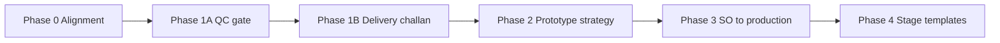

# BagProject — implementation plan (prioritized phases)

**Principles (from Project context):** Additive migrations only; no `migrate:fresh` / `migrate:refresh`; no drops, truncates, or business data loss; reuse working modules; minimal new abstractions.

**Strategic decision:** Implement in **`D:\laragon\www\bagfactoryerp`** (Laravel). Treat **`D:\laragon\www\BagProject`** as UX/reference unless explicitly merged into a monorepo or replaced by a real API consumer.

---

## Phase 0 — Alignment (1 short increment)

| Task | Outcome |
|------|---------|
| Update Project context path docs | State `bagfactoryerp` = Laravel app, `BagProject` = Next prototype |
| Initialize git for BagProject (optional) | Track docs and prototype separately |
| Single “source of truth” checklist | Posting rules only in Laravel services |

**Exit criteria:** Team agrees Laravel folder is deployable app; prototype is not production.

---

## Phase 1 — Close critical workflow gaps (recommended first slice)

### Slice 1A — **Operational QC gate on bag production** ⭐ *Recommended first implementation slice*

**Why first:** Explicitly required in Project context; absent in both codebases; small additive surface; hooks into existing `BagBatchWorkflowService` before `completed` / `post`.

| Deliverable | Detail |
|-------------|--------|
| Migration | `bag_qc_inspections` (batch_id, inspector_id, result enum, notes, inspected_at) |
| Workflow | Require `qc_pass` transition (or record) before batch may move to `completed` |
| UI | Inertia form on batch show page |
| Tests | Feature test: cannot post without QC pass |

**Constraints:** No changes to existing posted batches; nullable QC for legacy rows or backfill script (read-only audit).

### Slice 1B — **Delivery challan / dispatch note**

| Deliverable | Detail |
|-------------|--------|
| Migration | `delivery_challans` + lines linked to `sales_order_id` or `sales_invoice_id` |
| Stock | Optional: post FG on challan vs invoice (decide one rule; document) |
| Print | PDF similar to existing sales invoice print |
| Prototype parity | Maps to `DocumentsView` “Delivery Challan” category |

### Slice 1C — **Project context doc fix**

Move or copy these audit docs into `bagfactoryerp/docs/` when implementation starts (optional symlink note in README).

---

## Phase 2 — Prototype integration or retirement

Pick **one**:

| Option | Work |
|--------|------|
| **A. Retire prototype as product** | Port any missing UX copy from BagProject views into Laravel Vue pages |
| **B. API + thin Next client** | Laravel API resources for dashboard/inventory; BagProject calls API; add persistence |
| **C. Monorepo** | `apps/web` (Next) + `apps/api` (Laravel) — highest coordination cost |

**Recommendation:** Option A unless a dedicated mobile/Next front end is required.

---

## Phase 3 — Production planning link to sales

| Task | Detail |
|------|--------|
| Link `bag_production_orders` to `sales_orders` | FK + UI picker |
| MRP-lite report | Open SO qty vs FG on hand vs planned batches |
| Prototype gap | Replace “invoice-only” sales in prototype if Option B |

---

## Phase 4 — Configurable production stages (if still required)

Laravel already has **status machines** in `config/bag.php` and Dana config—not arbitrary user-defined stages.

| Increment | Detail |
|-----------|--------|
| `production_stage_templates` master | Ordered stages per line (extrusion, printing, cutting, QC) |
| Batch stage log | Timestamp + operator per stage |
| Avoid | Rebuilding full MES; keep stage list short (≤ 6) |

---

## Phase 5 — Hardening & ops

| Task | Detail |
|------|--------|
| Documents hub in Laravel | Upload storage + link to PO/SO/invoice |
| BagProject stock transfer bug | Fix only if prototype kept (Option B) |
| Performance | Follow `bag-factory-erp-performance-audit.md` |
| CI | Run existing PHPUnit on each PR |

---

## Phase dependency diagram

---

## Effort characterization (technical, not calendar)

| Phase | Invasiveness | Risk |
|-------|--------------|------|
| 1A QC | Low — new table + workflow guard | Low if posting rules unchanged |
| 1B Delivery | Medium — new docs + print + stock policy choice | Medium — stock timing decision |
| 2 Integration | High if Option B/C | High |
| 3 SO link | Medium | Low |
| 4 Stages | Medium–high | Scope creep |

---

## Out of scope (per audit phase)

- Rewriting inventory posting engine
- migrate:fresh / data wipes
- Full ERP accounting enablement unless requested (`BAG_ACCOUNTING_INTEGRATION`)

---

## Success metrics

1. Bag batch cannot post without QC record (Phase 1A).
2. Delivery challan printable and linked to sales document (Phase 1B).
3. Purchase → GRN → balance remains green in existing tests.
4. Project context paths match disk layout.